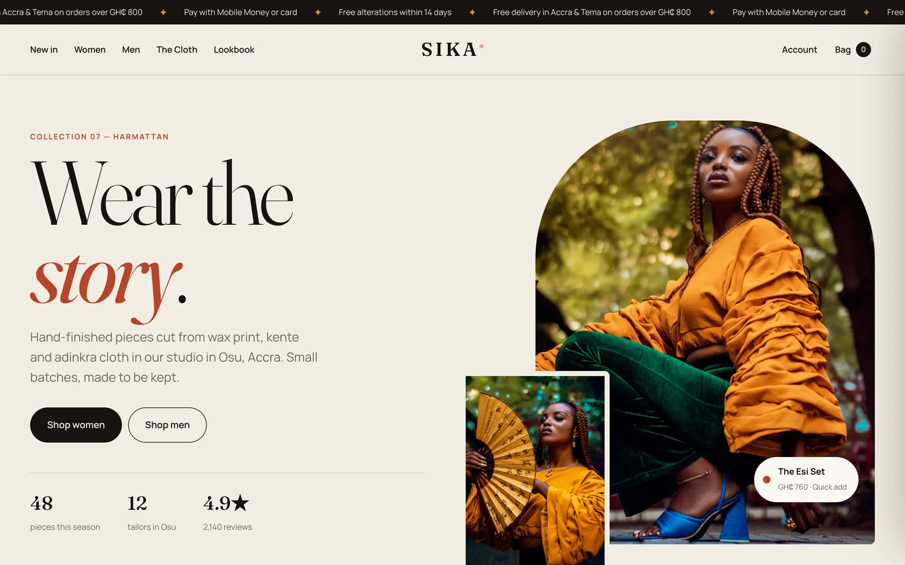
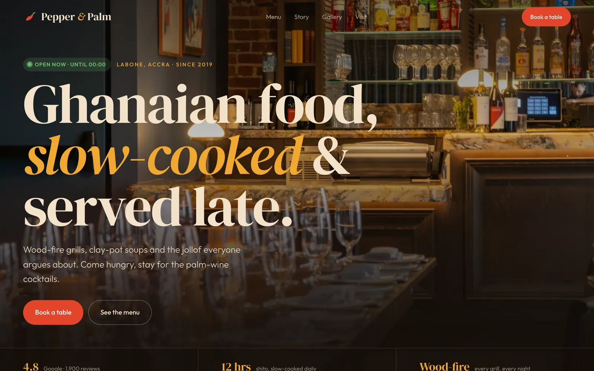
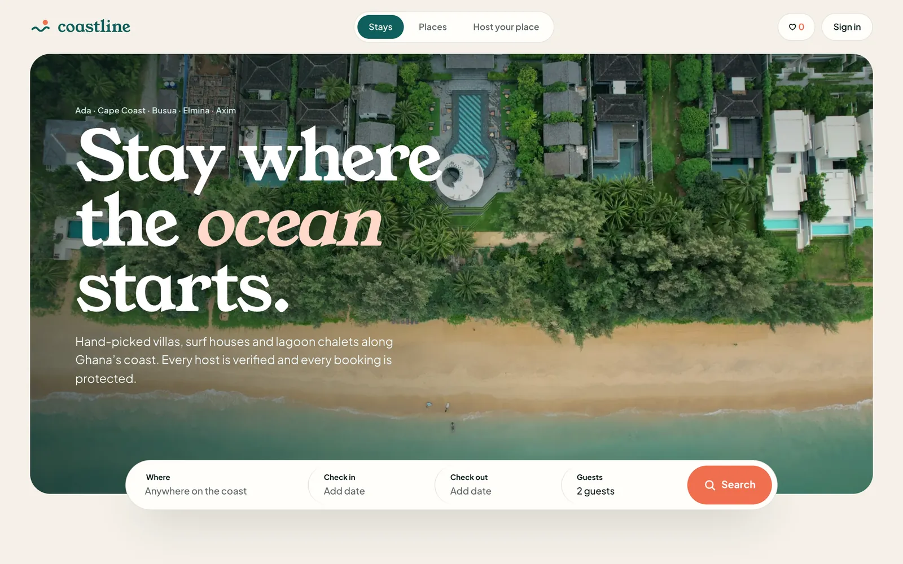
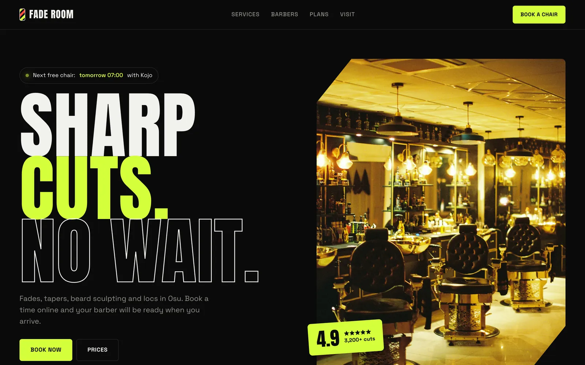

# Website Templates

Four complete, responsive website templates. Each one has real working features, not just static mockups. They are plain HTML, CSS and JavaScript with no build step and no dependencies.

**Live gallery:** https://creation20.github.io/website-templates/

| | Template | Type | Highlights |
|---|---|---|---|
|  | [**SIKA**](https://creation20.github.io/website-templates/sika/) | Fashion e-commerce | Category filters and sorting, quick-add size picker with sold-out sizes, cart drawer with quantities, free-delivery progress bar, cart saved in `localStorage`, lookbook carousel |
|  | [**Pepper & Palm**](https://creation20.github.io/website-templates/pepper-and-palm/) | Restaurant | Live open/closed status (Accra time), tabbed menu with keyboard support, spice levels and vegetarian filter, reservation form with validation and a booking ticket, opening hours with today highlighted |
|  | [**Coastline**](https://creation20.github.io/website-templates/coastline/) | Booking / holiday stays | Custom date-range calendar, guests and pets picker, filters, price slider and sorting, wishlist, stay detail with gallery and price breakdown (nights, cleaning, service fee, weekly discount), reservation flow |
|  | [**Fade Room**](https://creation20.github.io/website-templates/fade-room/) | Appointments | Four-step booking wizard (service and add-ons, barber, day and time slots, details), live summary and total, "next free chair" finder, downloadable `.ics` calendar invite, memberships, image preview on hover |

## Using a template

Each folder is self-contained. Copy one, open `index.html` in a browser, and edit:

- **Content:** product, menu, stay and service data lives in the arrays at the top of each `main.js`.
- **Colours and fonts:** CSS custom properties at the top of each `style.css`.
- **Images:** swap the files in each `img/` folder (WebP, already optimised).

The demos stop where a real backend would take over. Checkout, reservations and bookings are where you would connect Paystack, Hubtel, MoMo, a calendar API or your own server.

## Built with

- Semantic HTML, modern CSS (grid, custom properties, `dialog`, `clamp()`), vanilla JS
- Responsive from 360 px phones to wide desktops, with `prefers-reduced-motion` respected
- Google Fonts: Fraunces, Manrope, DM Serif Display, Outfit, Young Serif, Plus Jakarta Sans, Anton, Space Grotesk

## Credits

Designed and built by [William Bentil](https://github.com/Creation20). All brands, people, prices and listings are fictional. Photos are from [Unsplash](https://unsplash.com) under the Unsplash License; source photo IDs are listed in `photo-credits.json`.

Code released under the [MIT License](LICENSE).
